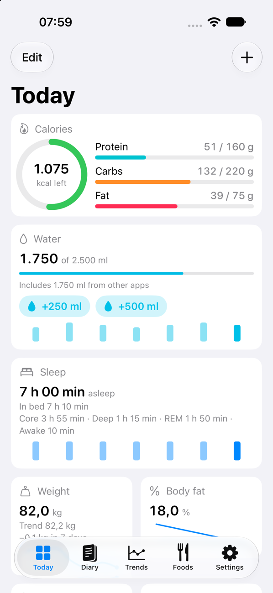
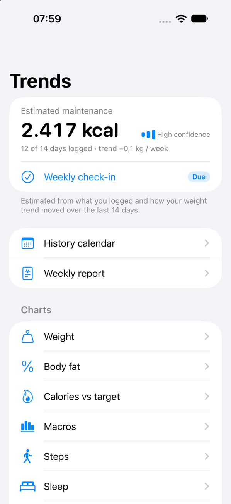
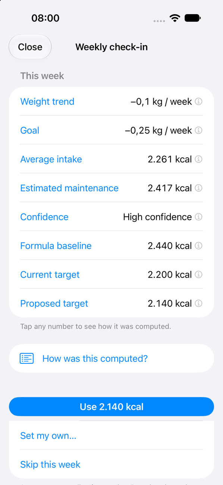
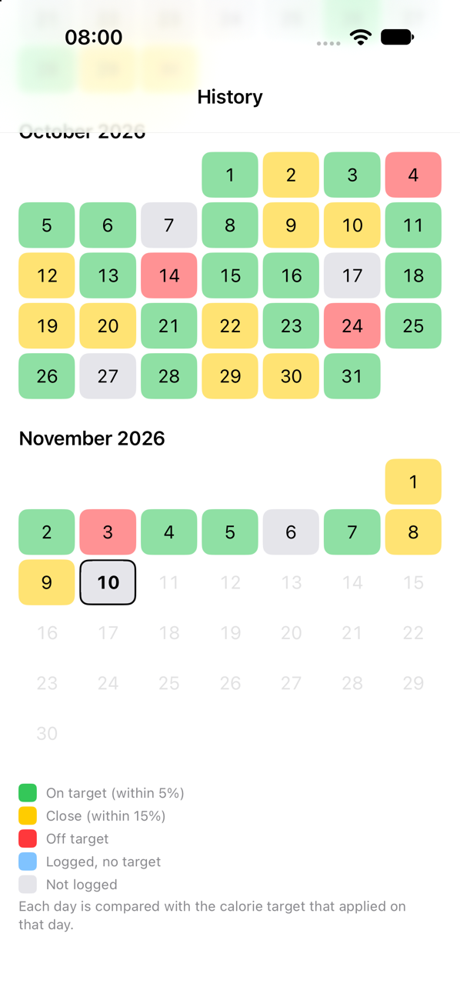
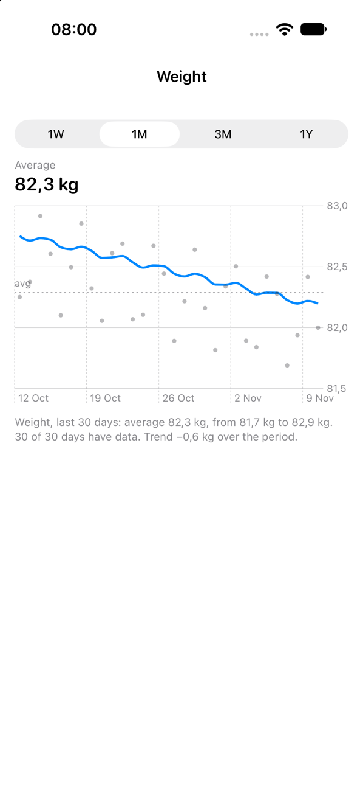
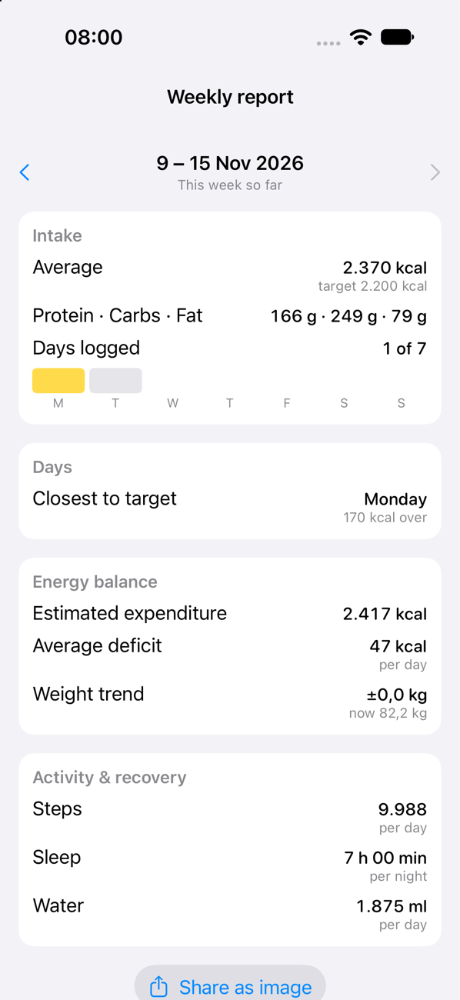

# Vitalion

**A free, ad-free, open-source, privacy-first nutrition & health tracker for iOS.**

Log what you eat (barcode scan, search, saved meals) and see it next to how your body responds — weight trend, body fat, steps, sleep, resting heart rate, HRV — all pulled from Apple Health. No account, no cloud, no telemetry.

> Status: **v1.0 feature-complete** (phases 1–3 of the [roadmap](docs/SPEC.md#13-roadmap)): diary, barcode scanning, Apple Health, saved meals, adaptive TDEE with a weekly check-in, history, charts, weekly report, Shortcuts and widgets. Next is phase 4 (optional self-hosted sync and a web client). Release notes: [docs/RELEASE_NOTES_1.0.0.md](docs/RELEASE_NOTES_1.0.0.md).

| Today | Trends | Weekly check-in |
|---|---|---|
|  |  |  |

| History | Weight chart | Weekly report |
|---|---|---|
|  |  |  |

*Screenshots show the built-in sample data (`-uiSampleData`), not real data.*

## Features

- Fast food diary with meal slots, recents, favorites, quick-add, copy meal/day, and **saved meals** (a list of foods with amounts, built from scratch or from a logged meal; log it in one tap)
- Snap or describe a meal: a photo or a sentence becomes foods with amounts and calories, estimated on the iPhone by Apple Intelligence (no account, nothing sent anywhere)
- English and Croatian UI (follows the iOS language, incl. Settings → Vitalion → Language); bundled foods searchable by Croatian or English name
- Barcode scanning (VisionKit) with Open Food Facts lookup and one-tap manual entry when a product is missing
- Offline search over a bundled USDA FoodData Central subset + your own foods (SQLite FTS5, diacritic-insensitive); online search in Open Food Facts and USDA
- Calorie and macro targets, **adaptive maintenance (TDEE) estimate** from your intake and smoothed weight trend, and a **weekly check-in** that proposes a target — every number explains how it was computed
- Apple Health: reads steps, sleep (with stages), weight, body fat %, active and resting energy, resting HR, HRV, water; writes nutrients, water and manual weights
- Works with any scale/watch that syncs to Apple Health (built and tested with a Withings scale + Apple Watch)
- History calendar colored by adherence, charts (1W / 1M / 3M / 1Y) for weight and trend, body fat, calories vs target, macros, steps, sleep, heart rate, HRV, water and energy burned, and a shareable weekly report
- Siri / Shortcuts: log a favorite, quick-add calories, remaining calories, log water; Home Screen and Lock Screen widgets
- JSON/CSV export and import, automatic weekly on-device backups, duplicate-food merge — your data is always yours

Not planned: ads, subscriptions, social features, coaching, analytics SDKs.

## Requirements

- iOS 26.0+
- Xcode 26+, Swift 6
- An Apple Developer Program membership for HealthKit background delivery on a device (free accounts can build, but builds expire after 7 days)

## Build

```bash
git clone https://github.com/memphin/vitalion.git
cd vitalion
cp Config/Secrets.xcconfig.template Config/Secrets.xcconfig   # optional: USDA key, Team ID
open Vitalion.xcodeproj
```

1. Put your Apple Developer Team ID in `Config/Secrets.xcconfig` (`DEVELOPMENT_TEAM = ...`) or pick your team in Xcode → `Vitalion` target → Signing & Capabilities.
2. HealthKit (with *Background Delivery*) and the App Group the widgets read from (`group.hr.ivanjuric.nutrilog`) are already declared in the entitlements. With your own bundle ID, change the group in `project.yml` and `Shared/WidgetSnapshot.swift` to match.
3. Run on a real iPhone (HealthKit is limited in the simulator). Simulator builds and tests work without a team.

The Xcode project is generated from `project.yml` with [XcodeGen](https://github.com/yonaskolb/XcodeGen). After changing targets, files or settings: `brew install xcodegen && xcodegen generate`, and commit both `project.yml` and `Vitalion.xcodeproj`.

Tests: `xcodebuild test -project Vitalion.xcodeproj -scheme Vitalion -destination 'platform=iOS Simulator,name=iPhone 17' CODE_SIGNING_ALLOWED=NO`, or `swift test` inside any `Packages/<name>`.

### Optional: USDA FoodData Central key

The app works without one (bundled foods + Open Food Facts). For online USDA search either paste a free key in **Settings → Food sources** (stored in Keychain) or put it in `Config/Secrets.xcconfig` (git-ignored). Never commit a key — USDA deactivates keys found in public repos.

## Project layout

```
App/            SwiftUI app, DI, navigation; App Intents (Siri / Shortcuts) in App/Sources/Intents
Packages/       Swift packages: Core, Persistence (GRDB), FoodSources, FoodLookup, HealthKitClient, Scanner, DesignSystem
Widgets/        WidgetKit extension (Home Screen and Lock Screen widgets)
Shared/         Code compiled into both the app and the widget extension
Resources/      Bundled food index, licenses
tools/          Scripts (e.g. build the bundled USDA food index)
docs/           SPEC.md (product & technical specification), ADRs
```

## Data sources & attribution

- **Open Food Facts** — packaged products by barcode. © Open Food Facts contributors, [ODbL 1.0](https://opendatacommons.org/licenses/odbl/1-0/). Product data is cached on-device only and never committed to this repository.
- **USDA FoodData Central** — generic foods. Public domain (CC0 1.0). A curated subset is bundled with the app.
- **Apple HealthKit** — your own health data, on-device.

## Privacy

See [PRIVACY.md](PRIVACY.md). Short version: the only network calls are to Open Food Facts and (optionally) USDA. Nothing else leaves your phone.

## Contributing

Issues and PRs welcome — read [CONTRIBUTING.md](CONTRIBUTING.md) first. This is a personal project built in spare time; response times vary.

## License

Code: [MIT](LICENSE). Bundled datasets keep their own licenses (see above).

*Vitalion is not a medical device and provides no medical advice.*
